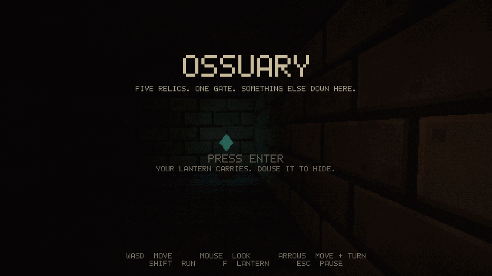

# Ossuary

A first-person horror prototype written in HolyC. Find five relics in a catacomb, open the gate, and get out before the warden finds you.

**Documentation: https://yatovoid.github.io/ossuary/**



The game is HolyC from the entry point down: state machine, entities, enemy AI, collision, pathfinding, procedural textures, bitmap font, HUD, and the renderer's draw logic. [hcc](https://github.com/Jamesbarford/holyc-lang) compiles it into a native Linux or macOS executable that calls SDL2 and OpenGL 3.3 directly through `extern "c"` declarations. It is not a TempleOS port and does not need TempleOS or a VM.

## Quick start

Install hcc and SDL2 first ([setup guide](docs/setup.md)).

```sh
./build/scripts/build-linux.sh      # or build-macos.sh
./build/out/ossuary
./build/scripts/test.sh             # headless gameplay tests
```

On Windows the game builds and runs inside WSL2, because hcc has no Windows backend:

```powershell
.\build\scripts\build-windows.ps1 -Run
```

## Docs

| Page | Covers |
|---|---|
| [Setup](docs/setup.md) | Installing hcc and SDL2, checking OpenGL on each platform |
| [Build and test](docs/build.md) | Build scripts, tests, render captures, building the docs |
| [Controls](docs/controls.md) and [Gameplay](docs/gameplay.md) | How to play |
| [Architecture](docs/architecture.md) | Runtime, rendering, game logic, input and state layers |
| [Contributing](docs/contributing.md) | Workflow, code style, and the hcc bugs to avoid |
| [Roadmap](docs/roadmap.md) and [FAQ](docs/faq.md) | What's next, common problems |

## Status

Builds, passes its tests, and plays start to finish on Linux. macOS and WSL2 builds have not been tried yet. No audio, one level.
