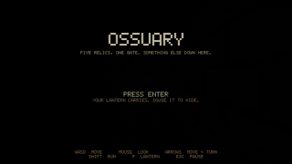

<h1 align="center">Ossuary</h1>

<p align="center">
  <a href="docs/media/preview.mp4">
    
  </a>
</p>

<p align="center">
  <b>Gameplay preview</b> from the current prototype.
  Every frame comes from the game's own renderer and simulation. The shots are staged, and the input is scripted
  (<a href="tests/preview_capture.HC"><code>tests/preview_capture.HC</code></a>).
  <a href="docs/media/preview.mp4">Watch the MP4</a> for full quality.
</p>

<p align="center">
  <b>First-person catacomb horror</b> &middot; one level &middot; prototype<br>
  Find five relics in the dark. Open the gate. Get out before the warden finds you.<br>
  Your lantern lets you see, and it lets the warden see you.
</p>

<p align="center">
  <b><a href="https://yatovoid.itch.io/ossuary-holyc">Download on itch.io</a></b> (Linux)
  &middot; <b><a href="https://yatovoid.github.io/ossuary/">Documentation</a></b>
  &middot; <a href="docs/controls.md">Controls</a>
  &middot; <a href="docs/gameplay.md">How the warden hunts</a>
</p>

## About

The game is HolyC from the entry point down: state machine, entities, enemy AI, collision, pathfinding, procedural textures, bitmap font, HUD, and the renderer's draw logic. [hcc](https://github.com/Jamesbarford/holyc-lang) compiles it into a native Linux or macOS executable that calls SDL2 and OpenGL 3.3 directly through `extern "c"` declarations. It is not a TempleOS port and does not need TempleOS or a VM.

## Quick start

Install hcc and SDL2 first ([setup guide](docs/setup.md)).

```sh
./build/scripts/build-linux.sh      # or build-macos.sh
./build/out/ossuary
./build/scripts/test.sh             # headless gameplay tests
```

On Windows the game builds and runs inside WSL2, because hcc has no Windows backend:

```powershell
.\build\scripts\build-windows.ps1 -Run
```

## Docs

| Page | Covers |
|---|---|
| [Setup](docs/setup.md) | Installing hcc and SDL2, checking OpenGL on each platform |
| [Build and test](docs/build.md) | Build scripts, tests, render captures, recording the preview, building the docs |
| [Controls](docs/controls.md) and [Gameplay](docs/gameplay.md) | How to play |
| [Architecture](docs/architecture.md) | Runtime, rendering, game logic, input and state layers |
| [Contributing](docs/contributing.md) | Workflow, code style, and the hcc bugs to avoid |
| [Roadmap](docs/roadmap.md) and [FAQ](docs/faq.md) | What's next, common problems |

## Status

Version 0.1.0 is on [itch.io](https://yatovoid.itch.io/ossuary-holyc) for Linux x86_64. It builds, passes its tests, and plays start to finish on Linux. macOS and WSL2 builds have not been tried yet. No audio, one level.
