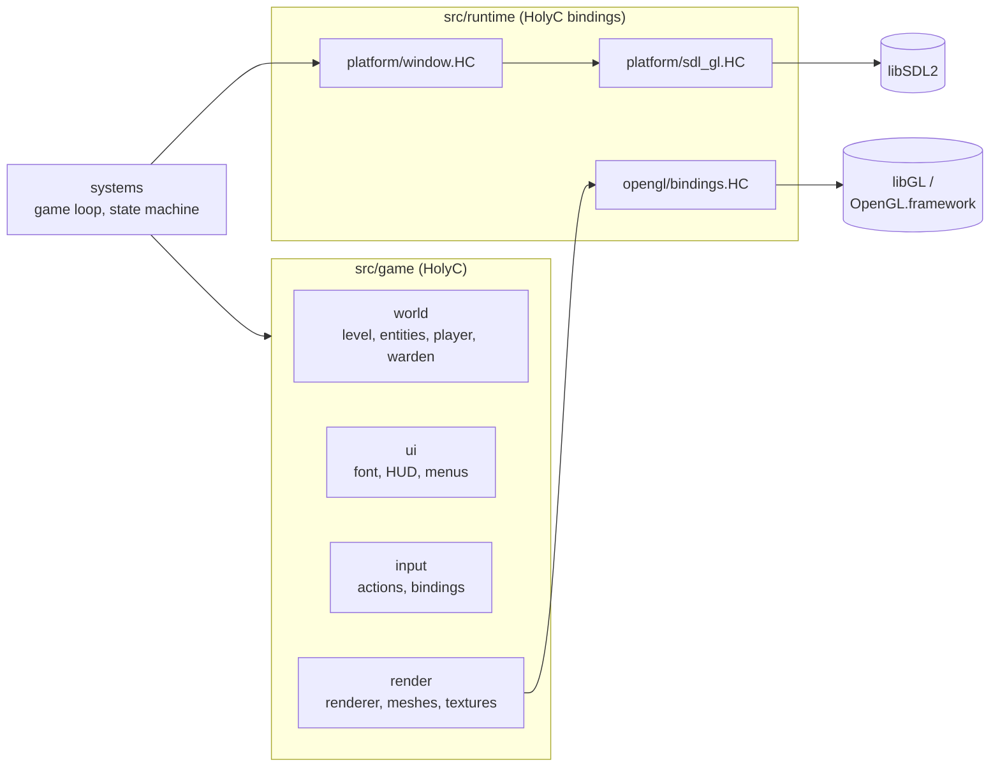
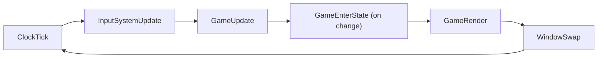
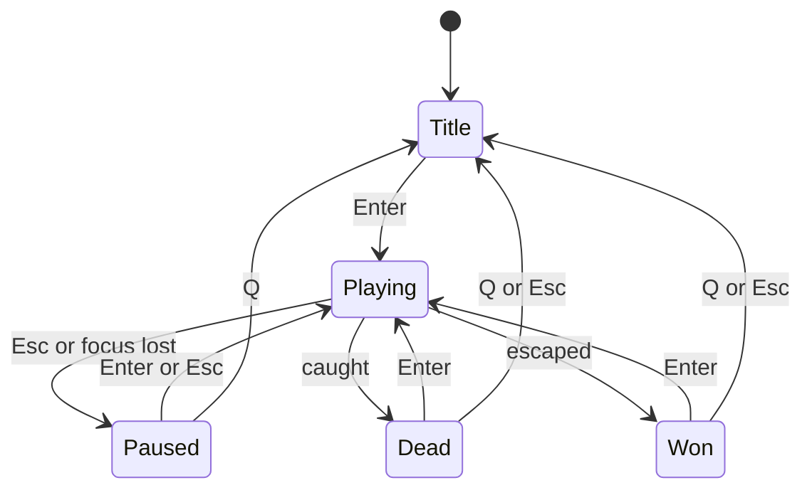
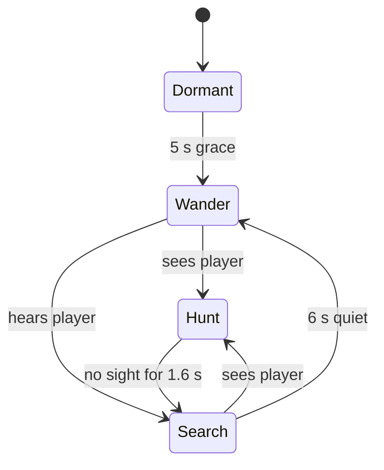

# Architecture

Every game source file is HolyC. There is no C shim and no C++. HolyC calls SDL2 and OpenGL directly through `extern "c"` declarations, and `#link` adds the shared libraries to the link line. GLSL shaders are the only other code, because the GPU requires them. `core/` (math, memory, time) is used by everything and left out of the diagram.



## Runtime layer

`src/runtime/` is the only code that names SDL2 functions or declares OpenGL entry points.

| File | Contents |
|---|---|
| `platform/sdl_gl.HC` | `#link <SDL2>`, SDL2 `extern "c"` declarations, constants, scancodes |
| `platform/window.HC` | The HolyC platform API the game uses |
| `opengl/bindings.HC` | `#link <GL>` on Linux, OpenGL 3.3 core `extern "c"` declarations and constants |

The platform API in `window.HC` is small:

| Function | Purpose |
|---|---|
| `WindowOpen`, `WindowClose` | Create the window and a GL 3.3 core context, tear them down |
| `WindowPump` | Drain events, record quit requests, track the drawable size |
| `WindowSwap` | Present the frame (vsync, adaptive when the driver supports it) |
| `WindowFocused`, `WindowCaptureMouse` | Focus check, relative mouse mode |
| `WindowKeys`, `WindowMouseDelta` | Keyboard state array and mouse motion since the last call |
| `PlatformCounter`, `PlatformFrequency` | High-resolution timer |
| `PlatformBasePath` | Executable directory, used to find `assets/` |

Only scancode constants escape this layer, for key bindings. `WindowPump` reads just the 32-bit type field of `SDL_Event`, which has been stable since SDL 2.0, so no SDL struct layouts are mirrored in HolyC.

On Linux and macOS, `libGL` and `OpenGL.framework` export every 3.3 core function directly, so there is no function-pointer loader.

### Why SDL2 and OpenGL

- **One API for every target.** SDL2 covers window, context, input, timing and HiDPI on X11, Wayland, macOS and Windows. Binding Xlib, Wayland, Cocoa and Win32 separately from HolyC would multiply the runtime layer for no gain.
- **OpenGL 3.3 core is the widest common target.** Mesa and vendor drivers on Linux, 4.1 core on macOS, and Mesa's D3D12 driver under WSLg all provide it. Vulkan would need MoltenVK on macOS and far more setup. Metal and Direct3D are single-platform.
- **Both are plain C ABIs.** hcc passes integer, pointer and float arguments to C correctly, which covers everything the game calls. No callbacks into HolyC are needed.

## Game logic layer

`src/game/world/` is pure simulation. It never calls OpenGL, which is what makes headless testing possible.

| File | Responsibility |
|---|---|
| `level.HC` | Parses the ASCII map, grid collision, line of sight, BFS flow field, level mesh generation |
| `entity.HC` | Fixed pool of 64 tagged entities: relic, candle, warden, gate |
| `player.HC` | Mouse and keyboard look, movement, stamina, noise, lantern, head bob |
| `warden.HC` | Enemy state machine: perception, wandering, path following, lunge |
| `world.HC` | The `World` struct, spawning from map markers, relic pickup, gate, dread, win and loss |

Level mesh generation is the one GPU-facing function in `level.HC`, and the game loop calls it separately from `WorldInit`, so tests never touch it.

Entities are one struct with a `kind` tag rather than a full ECS. With four kinds and fewer than twenty live entities, a tagged pool is simpler and fast enough.

### Collision

The player and warden collide as squares against the cell grid, one axis at a time, which gives wall sliding for free. The frame-time clamp (50 ms) keeps a single step shorter than a cell, which the resolution relies on.

### Pathfinding

`LevelBuildFlow` runs a breadth-first search from the player's cell over the whole grid and stores the distance in every cell. A chaser steps to whichever neighbour has the lowest distance. The field is rebuilt only when the player changes cell, which on a 27x21 map costs microseconds.

## Rendering layer

| File | Responsibility |
|---|---|
| `renderer.HC` | Frame setup, light selection, draw order, post pass |
| `shader.HC` | Loads GLSL from `assets/shaders/`, compiles, links, reports errors |
| `mesh.HC` | Interleaved vertex builder (position, normal, UV), box and relic meshes |
| `texture.HC` | Procedural textures: brick, flagstone, rock, cloth, iron |
| `camera.HC` | View and projection matrices from position, yaw and pitch |
| `ui_batch.HC` | Batched 2D quads for text and rectangles |

Each frame:

1. The scene draws into an offscreen framebuffer fixed at 240 pixels tall, width following the window aspect.
2. `world.vert` snaps vertices to that pixel grid. `world.frag` lights each pixel from up to 8 point lights and applies exponential-squared fog.
3. Light slot 0 is always the lantern. The other seven are the nearest of: candles, relics, the hunting warden's glow, and moonlight past the open gate.
4. `post.frag` scales the scene up with nearest filtering and adds vignette, the dread tint, film grain, and 4x4 ordered dithering to 5 bits per channel.
5. The UI draws on top at native resolution with an integer scale (`height / 270`), from one atlas texture, in one draw call.

The repository ships no image files. Textures are generated at startup from tileable value noise in HolyC, and the font is a 64-glyph 5x7 bitmap table baked into an atlas.

## Input layer

`src/game/input/input.HC` maps physical keys to actions (`ACT_FORWARD`, `ACT_LANTERN`, and so on). Each action has a primary and a secondary binding. `InputDown` reads the current state and `InputPressed` detects the frame a key went down.

`src/game/systems/input_system.HC` fills that state once per frame: it pumps the window, keeps the previous frame's state for edge detection, reads the keyboard array, and reads mouse motion only while the mouse is captured and the window is focused.

## State and systems

`src/game/systems/game_loop.HC` owns the `Game` struct (window, input, clock, scratch arena, renderer, world, camera, state machine) and runs the loop:



The simulation uses a variable timestep with the frame delta clamped to 50 ms.

States live in `state_machine.HC`. Transitions are requested with `StateSet` and applied once per frame, so enter logic (resetting the world, capturing the mouse) runs in one place:



### Warden state machine



Wander picks a random turn at each cell and avoids reversing. Search and Hunt follow the flow field. Hunt switches to a direct lunge within 1.25 cells.

## Memory

Long-lived state sits in fixed-size structs (`Game`, `World`, `Level`, `EntityPool`) allocated once as globals. Temporary data for building meshes and textures comes from an 8 MB scratch arena that is rewound after each upload. Nothing is heap-allocated per frame.

## Project layout

```
src/
  main.HC                 entry point: includes ossuary.HC, defines Main
  ossuary.HC              include list in dependency order
  runtime/
    platform/sdl_gl.HC
    platform/window.HC
    opengl/bindings.HC
  game/
    core/                 types.HC, memory.HC, math.HC, time.HC
    input/                input.HC
    render/               renderer.HC, shader.HC, mesh.HC, camera.HC, texture.HC, ui_batch.HC
    world/                level.HC, entity.HC, player.HC, warden.HC, world.HC
    ui/                   font.HC, hud.HC, menu.HC
    systems/              game_loop.HC, state_machine.HC, input_system.HC
  assets/shaders/         world, post, ui (.vert and .frag)
tests/
  world_test.HC           headless gameplay tests
  render_capture.HC       renders fixed scenes to PPM
build/scripts/            build-linux.sh, build-macos.sh, build-windows.ps1, test.sh
docs/                     this site
```

hcc compiles one input file into one program, so the game is a single translation unit. Order in `ossuary.HC` matters: a file can use anything included above it. Tests include `ossuary.HC` too, which is why `Main` lives in its own file.
