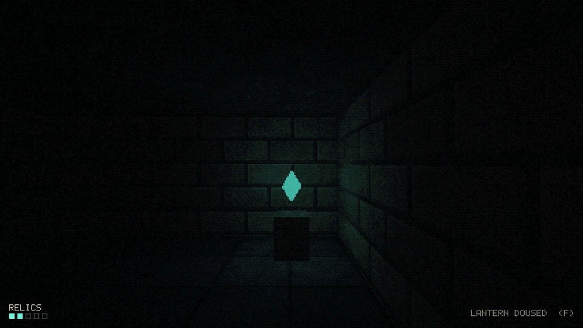
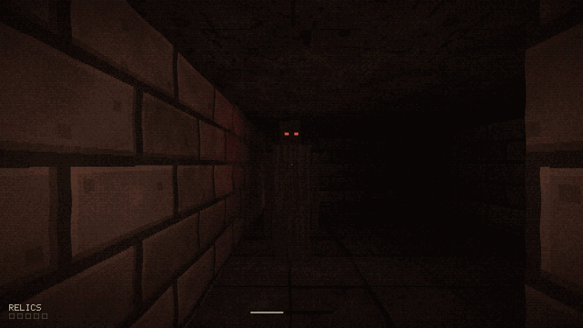
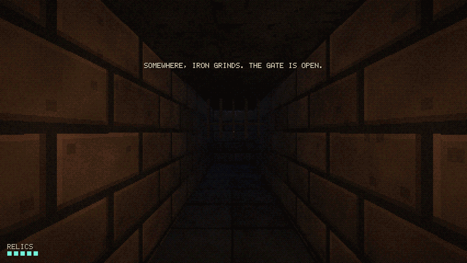

# Gameplay

## Goal

Find five relics in the catacomb. Taking the last one opens the iron gate in the far corner. Walk through it to escape. If the warden reaches you, the run ends.

A run takes a few minutes. The layout is fixed; the warden's wandering route changes every run.

## The lantern

The lantern is your main decision.

- **Lit:** you can see about six cells down a corridor. The warden can see the light from anywhere in its line of sight, up to about six cells away, whichever way it's facing.
- **Doused:** you see only by candles and the relics' glow. The warden only notices you if you're in front of it within about two and a half cells, or right next to it.

## Noise

| You are | The warden hears you within |
|---|---|
| Standing still | Never |
| Walking | About 2 cells |
| Running | About 5.5 cells |

Hearing isn't blocked by walls. A heard player sends the warden searching toward you, not hunting straight at you.

## Stamina

Running drains stamina in about three and a half seconds. Empty it and you're winded: no running until it refills past a quarter. Stamina recovers whenever you're not running. The bar appears at the bottom of the screen when it isn't full and turns red while you're winded.

## The warden

The warden stands still for the first five seconds of a run, then starts walking the corridors.

| Behaviour | Speed vs. you | Eyes | What it does |
|---|---|---|---|
| Wandering | Much slower than walking | Dim red | Picks random turns, rarely doubles back |
| Searching | Slower than walking | Brighter | Follows the shortest path to where you are now |
| Hunting | Faster than walking, slower than running | Bright, and it glows | Chases; lunges straight at you when close |

- Searching starts when it hears you and ends after six quiet seconds.
- Hunting starts when it sees you. Break line of sight for about a second and a half and it drops back to searching.
- Taking the last relic opens the gate, and the warden hears it. Expect a long search on your way out.

The screen reacts as it gets closer: the image desaturates toward red, the vignette tightens and pulses, and your lantern starts to shake.

## Relics

Relics float above brick pedestals and give off a pale teal light, which makes them visible down dark corridors. Walk into one to take it. The pips in the bottom-left corner track how many you hold.

## Winning and losing

- **Escape:** walk through the open gate. The view lifts toward the night sky and the screen fades out.
- **Caught:** the view turns to face the warden and fades to red.

Both end screens show relics collected and time survived. Press ++enter++ for a new run.

## Tuning

All of the numbers above are `#define`s, so balance changes don't need code changes:

| File | Constants |
|---|---|
| `src/game/world/player.HC` | Walk and run speed, stamina drain and regen, mouse sensitivity |
| `src/game/world/warden.HC` | Speeds, sight ranges, hearing radius, catch distance, timers |
| `src/game/world/world.HC` | Relic pickup range |
| `src/game/render/renderer.HC` | Fog density, scene resolution |

Run `./build/scripts/test.sh` after tuning. Several checks depend on these values.
